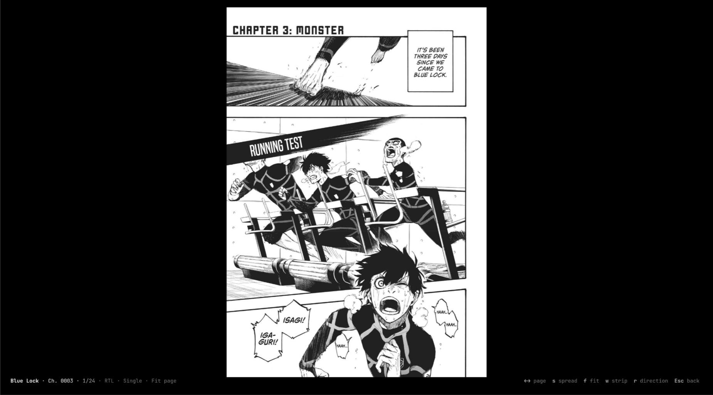
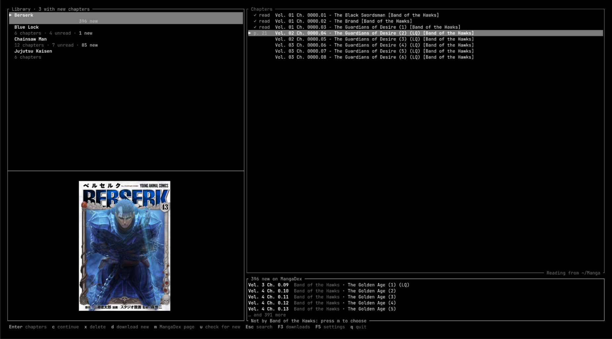
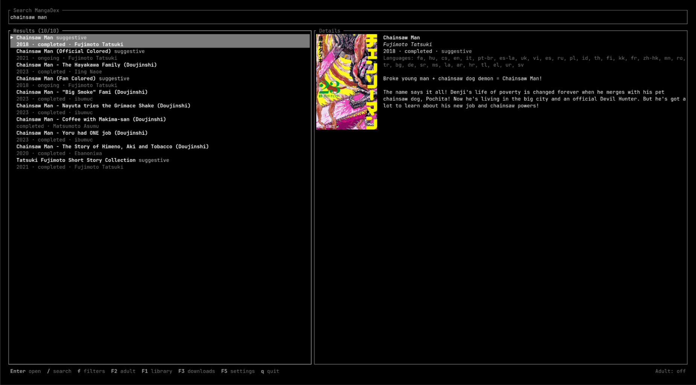
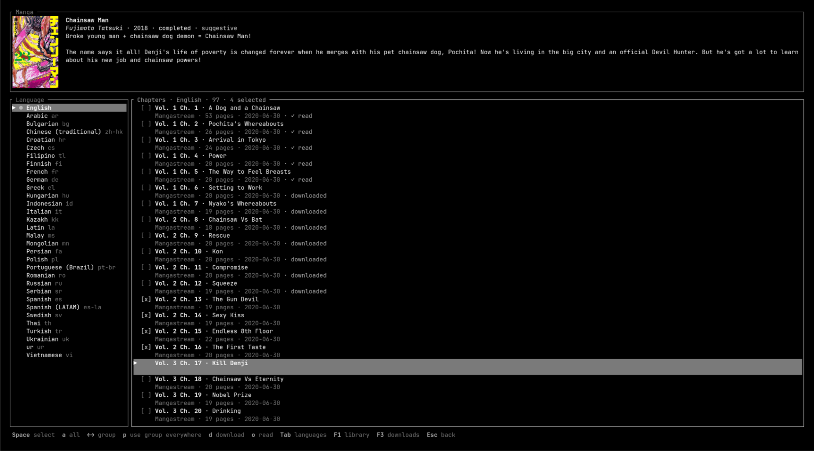

# toshokan

toshokan (図書館, "library" in Japanese) is a manga reader that lives in your terminal. You search MangaDex, download the chapters you want, and read them right there, with real images if your terminal can draw them.

toshokan is vibe coded. It was built mostly by prompting an AI coding assistant (Claude Code) and steering what came back.

## What it does

- Search MangaDex by title, or browse by status, demographic, year, tags and sort order.
- Download chapters as `.cbz` files (with ComicInfo.xml, so other readers pick up the metadata) or as plain image folders. You pick the scanlation group for each chapter and the image quality for each download. If you quit halfway, downloads pick up where they stopped next time.
- Read single pages or two-page spreads, right to left or left to right (set per manga), fitted to the screen or to its width. Webtoons get a long-strip mode that scrolls with the mouse wheel.
- Remember where you left off. Chapters get marked read when you finish them, and at the last page toshokan offers you the next one.
- Check the manga you follow for new chapters at startup, and queue them up from the same group you've been reading.
- Read what's already in your download folder too. Any `.cbz` or folder of images counts, even if toshokan didn't download it.

Adult titles stay hidden until you turn them on with F2.

## Screenshots

All of these were taken in Ghostty.

Reading a chapter:



The library, with your reading progress and the new chapters waiting on MangaDex:



Searching MangaDex:



Picking chapters to download from a manga's page:



## Setup

### What you need

- Rust 1.95 or newer. [rustup](https://rustup.rs) is the easiest way to get it.
- A C compiler, since the TLS library builds a bit of C.
- A terminal. Pages look best in Ghostty or kitty, where the terminal scales the images on the GPU and page turns are quick. Other terminals with Sixel or iTerm2 image support show real images as well. Everywhere else, and inside tmux, pages are drawn with half-block characters, which are readable but blurry.

toshokan is developed on Linux.

### Install

```sh
cargo install --locked --git https://github.com/jxpaa25/toshokan
```

That puts a `toshokan` binary in `~/.cargo/bin`. If you'd rather build from a clone:

```sh
git clone https://github.com/jxpaa25/toshokan
cd toshokan
cargo build --release
./target/release/toshokan
```

### First run

Start `toshokan` and you land in your library, which is empty the first time. Press Esc to go to search, type a title and hit Enter. Open a manga, mark chapters with Space and press `d`, then pick a quality and format and press Enter to start downloading. Finished chapters show up in the library (F1), where Enter starts reading.

Every screen lists its keys along the bottom, so there isn't much to memorize. These are the ones you'll use most:

| Key | Does |
| --- | --- |
| F1 | Library |
| F2 | Show or hide adult titles (in search) |
| F3 | Downloads |
| F4 | Search filters (in search) |
| F5 | Settings |
| q | Quit (Ctrl+C while you're typing in the search box) |

And in the reader:

| Key | Does |
| --- | --- |
| ← → | Turn the page (→ always means next, whichever way the manga reads) |
| s | Switch between single pages and spreads |
| f | Fit the page or fit the width |
| w | Long-strip mode on or off |
| r | Flip the reading direction |
| Esc | Close the reader |

### Settings

Press F5 to change the language a manga opens in, the download folder (`~/Manga` by default), the default image quality and format, and whether adult titles show up. Changes are saved right away, and if you move the download folder, toshokan offers to bring your library along.

The same settings live in `~/.config/toshokan/config.toml` if you prefer editing a file. Comments you add there are kept when the app saves. Reading progress and the download queue go in `~/.local/share/toshokan/`.

To point toshokan at a different folder without touching the config, set `TOSHOKAN_DIR`:

```sh
TOSHOKAN_DIR=~/manga-test toshokan
```

The folder setting is locked while it's set.

## Being nice to MangaDex

toshokan uses the public MangaDex API and follows its rules. It sends an honest User-Agent, stays under the rate limits, backs off when the server asks it to, and reports image downloads to the MangaDex@Home network as the API docs request. If you fork it, please keep those in place.

toshokan isn't affiliated with MangaDex.

## Working on it

```sh
cargo test                        # offline tests
cargo test -- --include-ignored   # also runs tests against the live MangaDex API
cargo clippy --all-targets
```

Debug builds optimize the image code, so `cargo run` is fast enough to actually read with.

## License

MIT, see [LICENSE](LICENSE).
